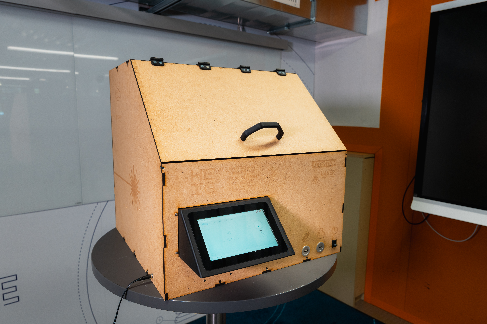
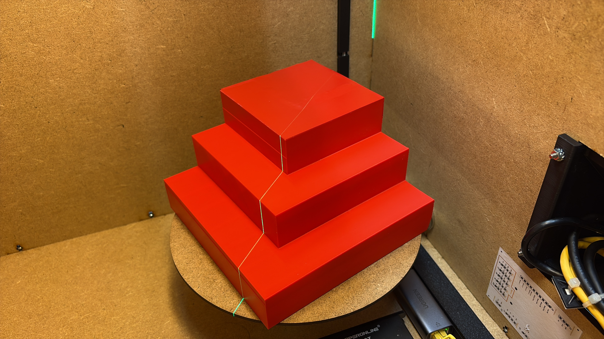
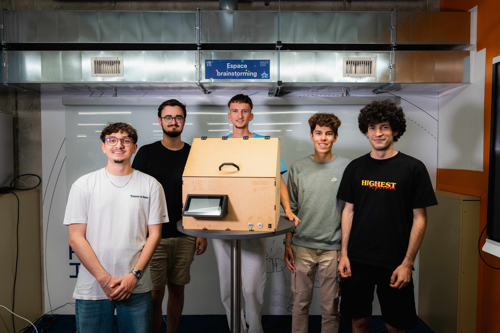

# Scanner 3D — donner une forme numérique au réel

  

  <strong>Un scanner 3D open source, compact et low-cost, conçu autour d'un Raspberry Pi.</strong> 
  Numérisez un objet, reconstruisez sa géométrie et exportez un modèle STL prêt à être réutilisé.

  <a href="assets/photo/poster_Scanner_3D.pdf">Voir le poster du projet</a> ·
  <a href="docs/rapport/">Lire le rapport complet</a>

---

## Le projet en une phrase

Scanner 3D transforme un objet posé sur un plateau rotatif en un modèle numérique exploitable grâce à une ligne laser, deux caméras et une chaîne logicielle complète — de la capture au maillage STL.

## De l'objet au modèle 3D

  
  

1. L'objet est placé au centre du plateau.
2. Le plateau effectue une rotation progressive sur 360°.
3. À chaque position, le laser dessine un profil lumineux et les deux caméras capturent la scène.
4. La ligne laser est détectée puis convertie en profil 3D par triangulation.
5. Les profils sont fusionnés en nuage de points, filtrés et transformés en maillage.
6. Le résultat est visualisable dans l'interface et exportable en STL ou OBJ.

## Pourquoi ce scanner ?

- **Accessible** — une architecture low-cost pensée pour un budget d'environ 300 CHF.
- **Autonome** — boîtier fermé, plateau motorisé, laser, caméras et écran tactile réunis dans un seul système.
- **Pédagogique** — mécanique, électronique, vision, géométrie 3D et interface web dans un même projet.
- **Pratique** — un parcours de scan simple, avec aperçu, suivi de progression et téléchargement du résultat.
- **Reproductible** — configuration YAML, calibration guidée, simulation hardware et tests automatisés.

## Une architecture complète

  

| Couche | Rôle |
| --- | --- |
| **Acquisition** | Capture synchronisée des deux caméras et commande du laser |
| **Vision** | Détection robuste de la ligne laser et réduction du bruit |
| **Géométrie** | Calibration caméra / laser, triangulation et fusion des deux vues |
| **Reconstruction** | Assemblage des profils en nuage de points puis maillage |
| **Interface** | Pilotage web, aperçu caméra, progression en temps réel et viewer 3D |
| **Matériel** | Raspberry Pi, moteur pas à pas, plateau rotatif, double caméra et écran local |

## Résultats

Le prototype répond aux objectifs du projet :

- acquisition d'un profil 3D à chaque rotation ;
- fusion des profils en nuage de points ;
- génération d'un maillage STL imprimable ;
- pilotage depuis une interface web Raspberry Pi ;
- fonctionnement dans une boîte fermée pour maîtriser la lumière ambiante ;
- objets ciblés jusqu'à environ **150 × 150 × 150 mm** et scan visé en moins de **10 minutes**.

  
  

Les raccourcis de déploiement, la calibration, le lancement sur Raspberry Pi et les routes de l'API sont documentés dans [README-technique.md](README-technique.md).

## Explorer les ressources

- [Poster de présentation](assets/photo/poster_Scanner_3D.pdf) — la synthèse visuelle du projet.
- [Rapport complet](docs/rapport/) — conception mécanique, électronique, logicielle et résultats.
- [Conception mécanique](docs/conceptionmecanique/) — pièces, assemblages, DXF et STL.
- [Schéma électronique](docs/schema/) — schéma et PCB KiCad.
- [Procédure de connexion](docs/connection_procedure.md) — relier le PC au Raspberry Pi.
- [Assets du projet](assets/photo/) — photos du prototype, captures d'écran et résultats 3D.

## L'équipe

Projet multidisciplinaire PMD — HEIG-VD, 2026

**[Tom Berthoud](https://github.com/tom-berthoud) · [Jason Weber](https://github.com/Jzn-wbr) · [Luc Marchand](https://github.com/luc-marchand) · [Tim Stamm](https://github.com/timstamm19) · [Hadrien Fuentes](https://github.com/hadrien-fuentes)**

Sous la responsabilité de **Cédric Bornand**.

> Projet étudiant : le scanner est un prototype expérimental. Le laser doit rester éteint lorsque le boîtier est ouvert et ne doit jamais être regardé directement.
